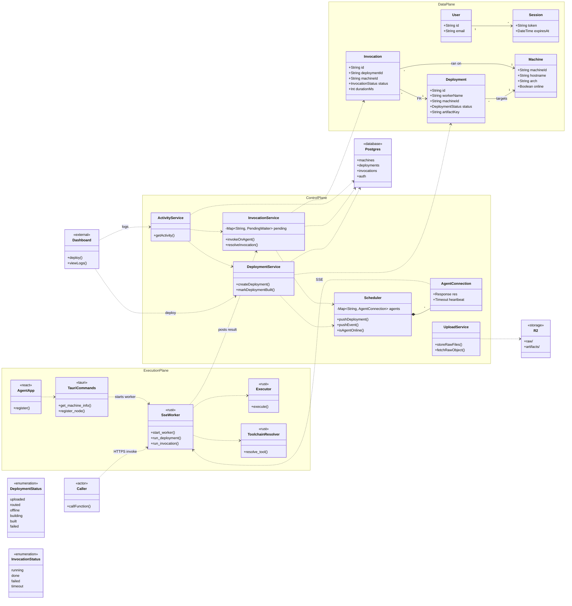

# 08 - Class Diagram

A UML class diagram of Hypercore, written as text so it can be rendered or
handed to another AI agent.

Two versions are provided:

| Version | Use it for |
|---------|------------|
| [Full](#1-full-class-diagram) | Mermaid renderers, code-aware agents, onboarding |
| [Compact](#2-compact-class-diagram-image-friendly) | Image-generation agents (fewer boxes, legible at poster size) |

---

## How to turn this into an image

1. **Best quality — render the Mermaid.** Paste either block into
   <https://mermaid.live>, the Mermaid CLI (`mmdc -i diagram.mmd -o out.png`),
   or any Mermaid plugin. The text stays sharp because it is drawn, not
   generated.
2. **Stylised poster — give an image model the prompt.** Image models cannot
   reliably draw 40 labelled boxes; they invent or misspell labels. Use the
   compact diagram plus the prompt in [section 3](#3-image-generation-prompt)
   and expect to fix text afterwards.
3. **Diagram-aware agents.** Feed the Mermaid block directly. Agents that can
   run code should render it with `mmdc` rather than drawing it freehand.

---

## 1. Full class diagram

```mermaid
classDiagram
    direction LR

    %% ------------------------------------------------------------------
    %% Actors and external systems
    %% ------------------------------------------------------------------
    class Caller {
        <<actor>>
        +HTTP request
    }
    class Dashboard {
        <<external>>
        +createFunction()
        +deploy()
        +viewLogs()
    }
    class Postgres {
        <<external>>
        +machines
        +deployments
        +invocations
        +user / session / account
        +verification / passkey
    }
    class CloudflareR2 {
        <<external>>
        +raw/deploymentId/*
        +artifacts/deploymentId/worker.wasm
    }

    %% ------------------------------------------------------------------
    %% Data plane - packages/db
    %% ------------------------------------------------------------------
    class User {
        <<entity>>
        +String id
        +String name
        +String email
        +Boolean emailVerified
        +String image
        +DateTime createdAt
        +DateTime updatedAt
    }
    class Session {
        <<entity>>
        +String id
        +String token
        +DateTime expiresAt
        +String ipAddress
        +String userAgent
        +String userId
    }
    class Account {
        <<entity>>
        +String id
        +String accountId
        +String providerId
        +String password
        +String userId
    }
    class Verification {
        <<entity>>
        +String id
        +String identifier
        +String value
        +DateTime expiresAt
    }
    class Passkey {
        <<entity>>
        +String id
        +String publicKey
        +String credentialId
        +Int counter
        +String deviceType
        +Boolean backedUp
        +String userId
    }
    class Machine {
        <<entity>>
        +String machineId
        +String hostname
        +String osName
        +String osVersion
        +String kernelVersion
        +String arch
        +Int cpuLogicalCores
        +Int cpuPhysicalCores
        +String cpuBrand
        +Int totalMemoryMb
        +Int usedMemoryMb
        +Int totalDiskMb
        +Int availableDiskMb
        +String localIp
        +DateTime firstSeenAt
        +DateTime lastSeenAt
    }
    class Deployment {
        <<entity>>
        +String id
        +String userId
        +String workerName
        +String machineId
        +String entrypoint
        +List~DeploymentFile~ files
        +DeploymentStatus status
        +String artifactKey
        +DateTime createdAt
        +DateTime updatedAt
    }
    class DeploymentFile {
        <<value object>>
        +String name
        +String key
        +Int size
        +String contentType
    }
    class Invocation {
        <<entity>>
        +String id
        +String userId
        +String deploymentId
        +String workerName
        +String machineId
        +String method
        +String path
        +InvocationStatus status
        +Int exitCode
        +Int durationMs
        +String stdoutPreview
        +String error
        +DateTime createdAt
        +DateTime finishedAt
    }

    %% ------------------------------------------------------------------
    %% Control plane - apps/api
    %% ------------------------------------------------------------------
    class HttpError {
        <<error>>
        +Int status
        +String message
    }
    class WorkerNameTakenError {
        <<error>>
        +String workerName
    }
    class Scheduler {
        <<infrastructure>>
        -Map~String, AgentConnection~ agents
        +addAgent(machineId, res)
        +removeAgent(machineId)
        +isAgentOnline(machineId) Boolean
        +listOnlineAgents() List~String~
        +pushEvent(machineId, event, data) Boolean
        +pushDeployment(payload) Boolean
    }
    class AgentConnection {
        <<infrastructure>>
        +Response res
        +Timeout heartbeat
    }
    class PendingWaiter {
        <<infrastructure>>
        +Timeout timer
        +String servedBy
        +Boolean fallback
        +settle(outcome)
    }

    class NodesService {
        <<service>>
        +registerMachine(payload) RegistrationResult
        +getMachineById(id) MachineRow
        +listMachines() List~MachineRow~
        +toMachineDto(row) MachineDto
    }
    class DeploymentService {
        <<service>>
        +createDeployment(input) DeploymentRow
        +getDeploymentById(id) DeploymentRow
        +getLatestBuiltDeployment(name) DeploymentRow
        +updateDeploymentStatus(id, status)
        +markDeploymentBuilt(id, key)
        +isWorkerNameTaken(name) Boolean
        +listDeploymentsByMachine(id, limit)
        +listDeploymentsByUser(id, limit)
    }
    class InvocationService {
        <<service>>
        -Map~String, PendingWaiter~ pending
        +invokeOnAgent(dispatch) InvokeOutcome
        +resolveInvocation(id, result)
        +persistAgentResult(id, result)
        +listInvocationsByMachine(id, limit)
        +listInvocationsByUser(id, limit)
    }
    class ActivityService {
        <<service>>
        +getActivity(machineId, limit) ActivityResult
        +toDeploymentDto(row) DeploymentDto
        +toInvocationDto(row) InvocationDto
    }
    class UploadService {
        <<service>>
        +sanitizeFileName(name) String
        +validateUploadInput(input)
        +resolveEntrypoint(names, requested) String
        +storeRawFiles(files) List~RawStoredFile~
        +assertReadableKey(key)
        +fetchRawObject(key) Stream
    }

    class NodesController {
        <<controller>>
        +registerNode(req, res)
        +listNodes(req, res)
        +getNode(req, res)
    }
    class DeploymentController {
        <<controller>>
        +routeDeployment(req, res)
        +uploadArtifact(req, res)
        +acknowledgeDeployment(req, res)
        +listMyDeployments(req, res)
    }
    class CodeUploadController {
        <<controller>>
        +uploadCode(req, res)
        +proxyFile(req, res)
        +getDeploymentFiles(req, res)
        +checkWorkerNameAvailability(req, res)
        +getTemplate(req, res)
    }
    class InvokeController {
        <<controller>>
        +invokeByDeploymentId(req, res)
        +invokeByWorkerName(req, res)
    }
    class InvocationsController {
        <<controller>>
        +postInvocationResult(req, res)
        +listMyInvocations(req, res)
    }
    class ActivityController {
        <<controller>>
        +getActivityByMachine(req, res)
    }
    class AgentsController {
        <<controller>>
        +streamEvents(req, res)
        +listOnline(req, res)
        +getStatus(req, res)
    }

    %% ------------------------------------------------------------------
    %% Wire contracts (DTOs)
    %% ------------------------------------------------------------------
    class MachineDto {
        <<dto>>
        +String machineId
        +String hostname
        +String osName
        +String arch
        +Int cpuLogicalCores
        +Int totalMemoryMb
        +String localIp
        +DateTime firstSeenAt
        +DateTime lastSeenAt
        +Boolean online
    }
    class RegistrationResult {
        <<dto>>
        +String status
        +String nodeId
        +String sessionToken
        +String assignedRegion
        +Int heartbeatIntervalSecs
    }
    class DeploymentPayload {
        <<dto>>
        +String deploymentId
        +String machineId
        +String objectKey
        +String workerName
        +String entrypoint
        +List~DeploymentFileRef~ files
    }
    class DeploymentFileRef {
        <<dto>>
        +String name
        +String key
    }
    class InvokeDispatch {
        <<dto>>
        +String machineId
        +String userId
        +String deploymentId
        +String workerName
        +String artifactKey
        +String method
        +String path
        +String query
        +String bodyB64
    }
    class AgentInvokeResult {
        <<dto>>
        +String machineId
        +Boolean ok
        +Int code
        +String stdoutB64
        +String stderr
        +String error
        +Boolean timedOut
    }
    class InvokeOutcome {
        <<dto>>
        +Boolean delivered
        +Boolean timeout
        +String servedBy
        +Boolean fallback
        +AgentInvokeResult result
    }
    class DeploymentDto {
        <<dto>>
        +String deploymentId
        +String workerName
        +String machineId
        +String entrypoint
        +DeploymentStatus status
        +String artifactKey
        +DateTime createdAt
    }
    class InvocationDto {
        <<dto>>
        +String invocationId
        +String deploymentId
        +String workerName
        +String machineId
        +String method
        +String path
        +InvocationStatus status
        +Int exitCode
        +Int durationMs
        +String stdoutPreview
        +String error
        +DateTime startedAt
        +DateTime finishedAt
    }
    class ActivityResult {
        <<dto>>
        +String source
        +Boolean online
        +List~DeploymentDto~ deployments
        +List~InvocationDto~ invocations
    }

    class DeploymentStatus {
        <<enumeration>>
        uploaded
        routed
        offline
        building
        built
        failed
    }
    class InvocationStatus {
        <<enumeration>>
        running
        done
        failed
        timeout
    }

    %% ------------------------------------------------------------------
    %% Execution plane - apps/agent
    %% ------------------------------------------------------------------
    class AgentApp {
        <<react>>
        +register()
        +pollActivity()
        +renderPages()
    }
    class TauriCommands {
        <<tauri>>
        +get_machine_info() MachineInfo
        +register_node(url, machineId) RegistrationResponse
        +get_saved_registration() SavedRegistration
        +unregister_node()
        +get_toolchain_status() ToolchainStatus
    }
    class SseWorker {
        <<rust>>
        +start_worker(config)
        +run_deployment(request)
        +handle_invoke(request)
        +run_invocation(request)
        +acknowledge(id, status)
        +download_file(key, path)
        +bundle_ts_to_js(entry)
        +compile_js_to_wasm(entry)
        +upload_artifact(id, wasm)
    }
    class Executor {
        <<rust>>
        +precache(wasm)
        +execute(input) ExecOutput
    }
    class ToolchainResolver {
        <<rust>>
        +resolve_tool(base) PathBuf
        +toolchain_status() ToolchainStatus
        +searched_locations(base) List~PathBuf~
    }
    class MachineInfoCollector {
        <<rust>>
        +get_machine_info() MachineInfo
        +collect_metrics() MetricsTick
    }

    class MachineInfo {
        <<rust-struct>>
        +String machineId
        +String hostname
        +String osName
        +String osVersion
        +String arch
        +Int cpuLogicalCores
        +Int totalMemoryMb
        +String localIp
    }
    class RegistrationResponse {
        <<rust-struct>>
        +String status
        +String nodeId
        +String sessionToken
        +String assignedRegion
        +Int heartbeatIntervalSecs
    }
    class SavedRegistration {
        <<rust-struct>>
        +String coordinatorUrl
        +String machineId
        +RegistrationResponse registration
    }
    class MetricsTick {
        <<rust-struct>>
        +Float cpuPercent
        +Int usedMemoryMb
        +Int totalMemoryMb
    }
    class ToolchainStatus {
        <<rust-struct>>
        +String esbuild
        +String javy
    }
    class SseConfig {
        <<rust-struct>>
        +String coordinatorUrl
        +String machineId
        +PathBuf toolsDir
    }
    class DeploymentRequest {
        <<rust-struct>>
        +String deploymentId
        +String machineId
        +String objectKey
        +String workerName
        +String entrypoint
        +List~DeploymentFileRef~ files
    }
    class InvokeRequest {
        <<rust-struct>>
        +String invocationId
        +String deploymentId
        +String machineId
        +String artifactKey
        +String method
        +String path
        +String query
        +String bodyB64
        +Int timeoutMs
        +Boolean fallback
        +String ownerMachineId
    }
    class ExecInput {
        <<rust-struct>>
        +Vec~u8~ wasm
        +Vec~u8~ stdin
        +Vec~String~ env
        +Int timeoutMs
    }
    class ExecOutput {
        <<rust-struct>>
        +Int code
        +Vec~u8~ stdout
        +String stderr
    }
    class ExecError {
        <<enumeration>>
        TimedOut
        FuelExhausted
        Failed
    }
    class CachedModule {
        <<rust-struct>>
        +Int wasmLen
        +Module module
    }

    %% ------------------------------------------------------------------
    %% Relationships - data plane
    %% ------------------------------------------------------------------
    User "1" --> "*" Session : owns
    User "1" --> "*" Account : links
    User "1" --> "*" Passkey : registers
    User "1" --> "*" Verification : requests
    Deployment "*" --> "0..1" User : owned by
    Deployment "*" --> "1" Machine : targets
    Invocation "*" --> "1" Deployment : FK deployment_id
    Invocation "*" --> "1" Machine : ran on

    %% ------------------------------------------------------------------
    %% Relationships - control plane
    %% ------------------------------------------------------------------
    Caller ..> InvokeController : GET /invoke/:id, /w/:name
    Dashboard ..> DeploymentController : deploy
    Dashboard ..> NodesController : list nodes
    Dashboard ..> ActivityController : read logs

    NodesController ..> NodesService
    DeploymentController ..> DeploymentService
    DeploymentController ..> UploadService
    CodeUploadController ..> UploadService
    CodeUploadController ..> DeploymentService
    InvokeController ..> InvocationService
    InvocationsController ..> InvocationService
    ActivityController ..> ActivityService
    AgentsController ..> Scheduler

    NodesService ..> Machine
    NodesService ..> Postgres
    DeploymentService ..> Deployment
    DeploymentService ..> Postgres
    InvocationService ..> Invocation
    InvocationService ..> Postgres
    ActivityService ..> DeploymentService
    ActivityService ..> InvocationService
    UploadService ..> CloudflareR2
    UploadService ..> Postgres

    DeploymentService ..> Scheduler : pushDeployment()
    InvocationService ..> Scheduler : pushEvent("invoke")
    ActivityService ..> Scheduler : isAgentOnline()
    Scheduler *-- "*" AgentConnection
    InvocationService *-- "*" PendingWaiter

    HttpError <|-- WorkerNameTakenError

    Machine ..> MachineDto : maps to
    Deployment ..> DeploymentDto : maps to
    Invocation ..> InvocationDto : maps to
    DeploymentDto ..> ActivityResult
    InvocationDto ..> ActivityResult

    %% ------------------------------------------------------------------
    %% Relationships - execution plane
    %% ------------------------------------------------------------------
    AgentApp ..> TauriCommands : Tauri IPC
    AgentApp ..> ActivityController : polls /activity
    TauriCommands ..> MachineInfoCollector
    TauriCommands ..> SavedRegistration
    MachineInfoCollector ..> MachineInfo
    MachineInfoCollector ..> MetricsTick
    SseWorker ..> SseConfig
    SseWorker ..> DeploymentRequest
    SseWorker ..> InvokeRequest
    SseWorker ..> ToolchainResolver
    SseWorker ..> Executor
    Executor ..> ExecInput
    Executor ..> ExecOutput
    Executor ..> ExecError
    Executor ..> CachedModule

    %% ------------------------------------------------------------------
    %% Wire links across the network
    %% ------------------------------------------------------------------
    AgentConnection ..> SseWorker : SSE event stream
    TauriCommands ..> NodesController : POST /api/v1/nodes/register
    SseWorker ..> InvocationsController : POST /invocations/:id/result
    SseWorker ..> DeploymentController : POST /deployment/:id/ack
    SseWorker ..> CloudflareR2 : via API proxy
```

### Notes on the model

| Notation | Meaning in this system |
|----------|------------------------|
| Solid `-->` | Durable relationship between stored records |
| Dashed `..>` | Runtime call, dependency, or data mapping |
| `*--` | The container owns its children (in-memory maps) |
| `<<entity>>` | A Drizzle table in `packages/db` |
| `<<service>>` | Business rules and database access in `apps/api/src/services` |
| `<<controller>>` | One function per endpoint in `apps/api/src/controllers` |
| `<<infrastructure>>` | Shared, process-local plumbing in `apps/api/src/lib` |
| `<<rust-struct>>` | A serialisable type in `apps/agent/src-tauri` |

Two edges are deliberately **not** foreign keys: `Deployment → Machine` and
`Invocation → Machine`. History must survive a node being removed. The only
enforced application FK is `Invocation → Deployment`.

---

## 2. Compact class diagram (image-friendly)

Use this when the target is an image model. It keeps the three planes and the
most important names, and drops fields that would become unreadable at poster
size.



---

## 3. Image-generation prompt

Paste this together with the compact diagram (or its rendered image) into the
image agent.

> Create a clean, high-resolution **UML class diagram poster** for a system
> called **Hypercore**. Landscape orientation, white background, technical
> blueprint aesthetic, thin dark-grey connector lines, generous spacing, and
> large legible labels.
>
> Arrange the diagram in **three vertical swimlanes**, left to right:
> 1. **Data Plane** (soft blue header) — `User`, `Session`, `Machine`,
>    `Deployment`, `Invocation`, plus a `PostgreSQL` cylinder.
> 2. **Control Plane** (soft amber header) — `Scheduler`, `AgentConnection`,
>    `DeploymentService`, `InvocationService`, `ActivityService`,
>    `UploadService`, plus a `Cloudflare R2` bucket icon.
> 3. **Execution Plane** (soft green header) — `AgentApp`, `TauriCommands`,
>    `SseWorker`, `Executor`, `ToolchainResolver`.
>
> Draw each class as a rounded rectangle with three compartments: class name on
> top, 2–4 fields in the middle, 2–4 methods at the bottom. Put the stereotype
> (`<<entity>>`, `<<service>>`, `<<rust>>`) in small caps above the name.
>
> Use solid arrows for stored relationships and dashed arrows for runtime
> calls. Label the important edges:
> `Deployment → Machine : targets`,
> `Invocation → Deployment : FK`,
> `Invocation → Machine : ran on`,
> `DeploymentService → Scheduler : pushDeployment()`,
> `InvocationService → Scheduler : pushEvent("invoke")`,
> `Scheduler ⇢ SseWorker : SSE event stream`,
> `SseWorker → Executor : execute()`,
> `SseWorker → InvocationService : POST result`.
>
> Add a legend in the bottom-right corner for solid vs dashed arrows and the
> four stereotypes. Title at the top: **Hypercore — Distributed TypeScript
> Runtime**. Subtitle: **Data · Control · Execution planes**.
>
> Keep the layout uncluttered. Prefer fewer boxes and larger text over
> cramming every field. Do not add decorative 3D effects or photographs.

### If the output text is garbled

That is normal for image models. Either:

- ask the model to redraw with **fewer labels**, then add text in a vector
  editor, or
- skip the image model and render the Mermaid block with `mmdc`, which
  produces exact text at any resolution.

---

## 4. Rendering locally

```bash
# one-off
npx -y @mermaid-js/mermaid-cli -i diagram.mmd -o class-diagram.png -w 2400

# inside this repo, from a file containing only the mermaid block
npx -y @mermaid-js/mermaid-cli -i docs/class-diagram.mmd -o docs/class-diagram.png
```

`mmdc` needs a Chromium install; on Windows the first run downloads one.
