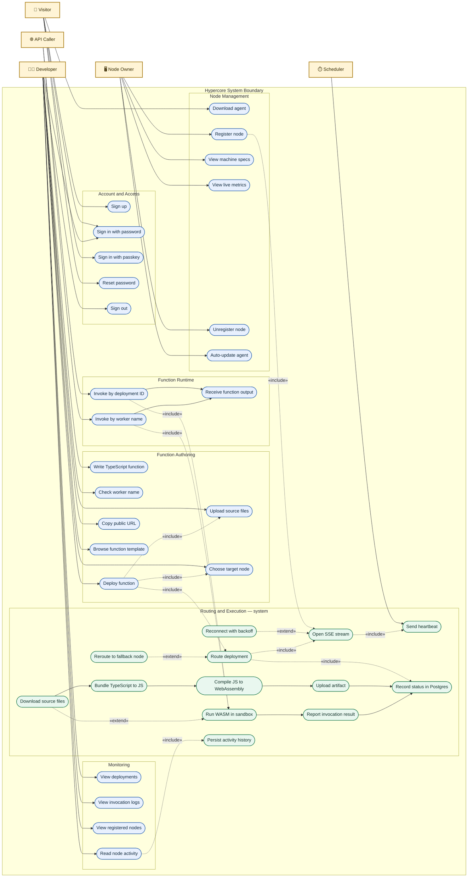
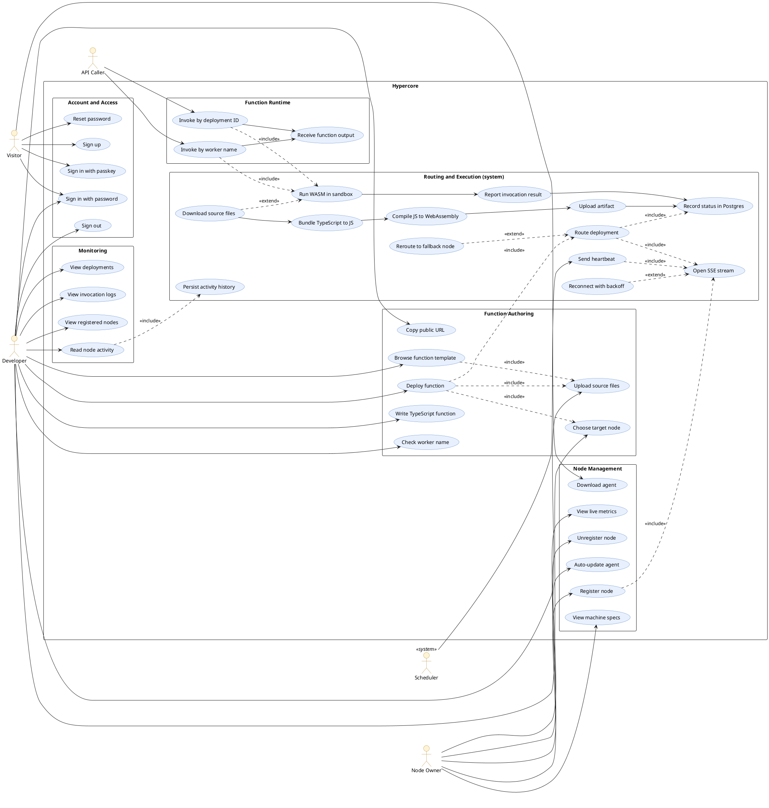
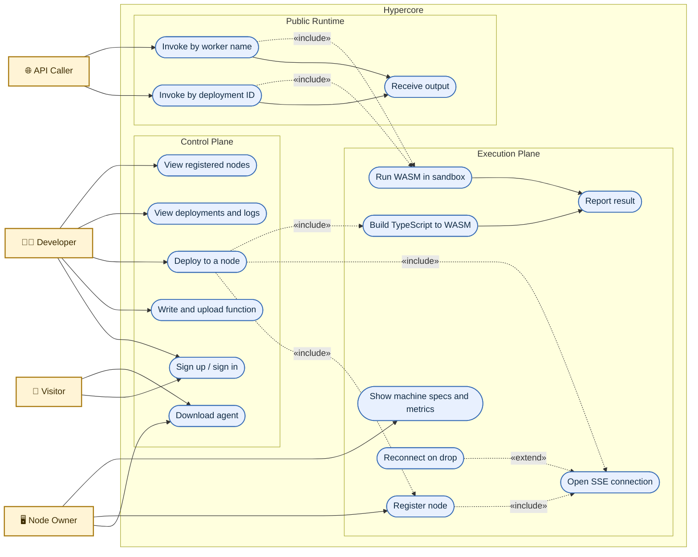

# 09 - Use Case Diagram

A UML **use case diagram** of Hypercore, written as text so it can be rendered
or handed to another AI agent.

Mermaid has no native use-case diagram type, so three forms are provided:

| Form | Best for |
|------|----------|
| [Mermaid flowchart](#1-mermaid-use-case-diagram) | Rendering in Mermaid Live, GitHub, or any Mermaid plugin |
| [PlantUML](#2-plantuml-native-use-case-diagram) | True UML semantics (`actor`, `usecase`, `<<include>>`, `<<extend>>`) |
| [Compact](#3-compact-use-case-diagram-image-friendly) | Image-generation agents — fewer ellipses, larger labels |

---

## 1. Mermaid use case diagram

Actors sit outside the boundary; ovals inside are use cases; dashed arrows are
`«include»` and `«extend»` relationships.



---

## 2. PlantUML native use case diagram

This version is the most faithful UML. Render it with the PlantUML server,
the VS Code extension, or `plantuml -tpng use-case.puml`.



---

## 3. Compact use case diagram (image-friendly)



---

## 4. Image-generation prompt

Paste this with the compact diagram (or its rendered image) into the image
agent.

> Create a clean, high-resolution **UML use case diagram poster** for a system
> called **Hypercore**. Landscape orientation, white background, technical
> blueprint style, thin dark-grey lines, generous spacing, and large legible
> labels.
>
> Draw **four actors as classic UML stick figures** down the left and right
> sides, outside the system boundary: `Visitor`, `Developer`, `Node Owner`,
> and `API Caller`.
>
> In the centre, draw a large rounded rectangle labelled **Hypercore** as the
> system boundary. Inside it, arrange use cases as **ellipses** in three
> labelled groups:
> - **Control Plane** (soft blue): Sign up / sign in, Write and upload
>   function, Deploy to a node, View deployments and logs, View registered
>   nodes, Download agent.
> - **Execution Plane** (soft green): Register node, Open SSE connection,
>   Build TypeScript to WASM, Run WASM in sandbox, Report result, Show machine
>   specs and metrics.
> - **Public Runtime** (soft amber): Invoke by deployment ID, Invoke by worker
>   name, Receive output.
>
> Connect actors to their use cases with solid lines. Use dashed arrows
> between use cases, labelled **«include»** and **«extend»**:
> `Deploy to a node → Open SSE connection : «include»`,
> `Invoke by worker name → Run WASM in sandbox : «include»`,
> `Run WASM in sandbox → Report result`,
> `Register node → Open SSE connection : «include»`.
>
> Add a small legend in the bottom-right for actor, use case, «include», and
> «extend». Title at the top: **Hypercore — Use Case Diagram**. Subtitle:
> **Who can do what in the system**.
>
> Keep it uncluttered: fewer ellipses with larger text beats cramming every
> edge. No 3D effects, no photographs, no decorative icons.

### If the text is garbled

Image models routinely misspell dense labels. Either render the Mermaid or
PlantUML source (exact text), or generate the layout and retype labels in a
vector editor.

---

## 5. Use case catalogue

The concrete trigger for each use case. Routes are from `apps/api/src/app.ts`.

| Actor | Use case | Trigger / route |
|-------|----------|-----------------|
| Visitor | Sign up | `POST /api/auth/sign-up/email` |
| Visitor | Sign in with password | `POST /api/auth/sign-in/email` |
| Visitor | Sign in with passkey | `POST /api/auth/passkey/*` |
| Visitor | Reset password | `POST /api/auth/forget-password` |
| Visitor / Node Owner | Download agent | `GET /download` (dashboard) |
| Developer | Upload source files | `POST /code-upload` |
| Developer | Check worker name | `GET /code-upload/check-name` |
| Developer | Browse template | `GET /code-upload/template` |
| Developer | Deploy function | `POST /deployment` |
| Developer | View deployments | `GET /deployment` |
| Developer | View invocation logs | `GET /invocations` |
| Developer | View registered nodes | `GET /api/v1/nodes` |
| Node Owner | Register node | `POST /api/v1/nodes/register` |
| Node Owner | View machine specs | Agent UI (Tauri `get_machine_info`) |
| Node Owner | View live metrics | Agent UI (local `metrics_tick`) |
| Node Owner | Unregister node | Agent UI (Tauri `unregister_node`) |
| API Caller | Invoke by deployment ID | `GET /invoke/:deploymentId` |
| API Caller | Invoke by worker name | `GET /w/:workerName` |
| Agent (system) | Open SSE stream | `GET /agents/events?machineId=…` |
| Agent (system) | Acknowledge build | `POST /deployment/:id/ack` |
| Agent (system) | Upload artifact | `POST /deployment/:id/artifact` |
| Agent (system) | Report invocation result | `POST /invocations/:id/result` |
| Agent (system) | Read activity | `GET /activity?machineId=…` |
| Agent (system) | Fetch source / artifact | `GET /code-upload/file?key=…` |
| Dashboard (system) | List online agents | `GET /agents/online` |
| Scheduler (system) | Heartbeat | SSE comment every 25 s |

### Relationship rules used above

| Relationship | Meaning |
|--------------|---------|
| Solid line, actor → use case | The actor can start that use case |
| `«include»` | The base use case always performs the included one |
| `«extend»` | The extending use case runs only under a condition (disconnect, cache miss, owner offline) |
| `«system»` actor | A timer or background process, not a person |

---

## 6. Rendering

```bash
# Mermaid
npx -y @mermaid-js/mermaid-cli -i use-case.mmd -o use-case.png -w 2400

# PlantUML (needs Java + plantuml.jar)
java -jar plantuml.jar -tpng use-case.puml
```

PlantUML also has a public server at <https://www.plantuml.com/plantuml> if
installing Java is not an option.
