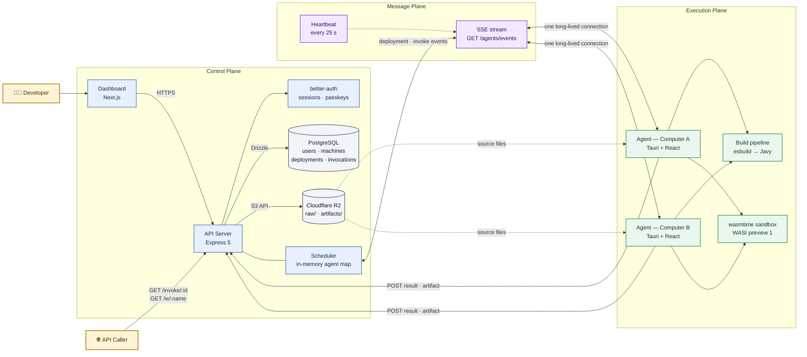
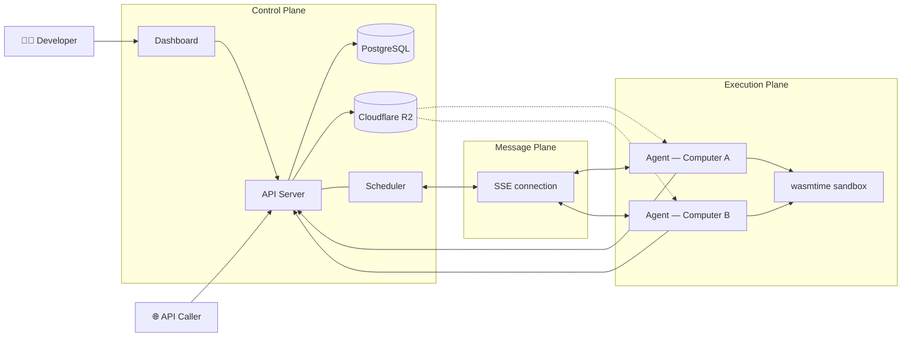

# 10 - High-Level Architecture Diagram

The three planes at a glance: who calls what, what is stored where, and how work
reaches a computer.

- **Text source:** the Mermaid block below, for exact rendering.
- **Image prompt:** section [3](#3-image-generation-prompt), for image agents.
- **Detailed version:** [01 - Architecture](./01-architecture.md).

---

## 1. High-level architecture (Mermaid)



### Reading the diagram

| Edge | Protocol | What travels |
|------|----------|--------------|
| Developer → Dashboard | HTTPS | Sign-in, editor, deploy clicks |
| Dashboard → API | HTTPS / JSON | Auth, uploads, deployment requests |
| API → PostgreSQL | Drizzle over TCP | Users, machines, deployments, invocations |
| API → R2 | S3 API | `raw/<id>/*` source, `artifacts/<id>/worker.wasm` |
| Scheduler ↔ Agent | SSE over one HTTP response | `connected`, `deployment`, `invoke`, heartbeat |
| Agent → API | HTTPS / JSON | Registration, build ack, artifact upload, invocation result |
| Caller → API | HTTPS | `GET /invoke/:id` or `GET /w/:name` |
| Agent → R2 | **never direct** | Files are proxied through the API |

The important asymmetry: the agent holds **no storage credentials** and the
server **never runs user code**.

---

## 2. Compact architecture (image-friendly)



---

## 3. Image-generation prompt

Paste this into the image agent. It is written to produce a **system
architecture diagram**, not a UML class diagram.

> Create a clean, high-resolution **system architecture diagram** for
> **Hypercore**, a distributed TypeScript runtime. Landscape orientation, white
> background, modern technical poster style, thin dark-grey connector lines,
> rounded rectangles, generous spacing, and large legible labels.
>
> Lay the diagram out in **three horizontal bands**, top to bottom, each with a
> coloured header:
>
> **Top band — Control Plane (soft blue).** On the far left, two user icons:
> `Developer` and `API Caller`. Next to them, a box labelled `Dashboard
> (Next.js)`. In the centre, the main box `API Server (Express 5)`. To its
> right, two storage cylinders labelled `PostgreSQL` (small caption: users,
> machines, deployments, invocations) and `Cloudflare R2` (small caption: raw/
> and artifacts/). Attach a small inner box to the API labelled `Scheduler
> (in-memory agent map)`. Draw solid arrows: Developer → Dashboard → API,
> API → PostgreSQL, API → R2.
>
> **Middle band — Message Plane (soft purple).** A single wide arrow or pipe
> labelled `SSE — one long-lived HTTP connection per computer`. On its left
> end, a small tag `GET /agents/events`; on the right, `heartbeat every 25 s`.
> This band is the only bridge between the top and bottom bands.
>
> **Bottom band — Execution Plane (soft green).** Two identical computer boxes
> side by side: `Agent — Computer A` and `Agent — Computer B`, each captioned
> `Tauri + React`. Inside or beneath each, two small boxes: `esbuild → Javy
> build pipeline` and `wasmtime sandbox (WASI)`. Draw dashed arrows from the
> Message Plane down into both agents, labelled `deployment` and `invoke`.
> Draw solid return arrows from both agents back up to the API Server, labelled
> `result · artifact`.
>
> Add a dashed arrow from `Cloudflare R2` to the agents labelled `source files
> via API proxy`, and a note: **the server never runs user code**.
>
> Include a compact legend: solid = synchronous HTTP/DB, dashed = pushed or
> proxied data, purple = message plane.
>
> Title at the top: **Hypercore — High-Level Architecture**. Subtitle:
> **Control Plane · Message Plane · Execution Plane**.
>
> Do not invent extra services, queues, brokers, or cloud providers. Keep the
> layout uncluttered; fewer boxes with larger text beats a dense diagram. No 3D
> effects, no photographs, no decorative icons.

### Style variants

| Want | Change in the prompt |
|------|----------------------|
| Isometric / 3D-ish | Replace "flat technical poster" with "subtle isometric layout, light shadows, no perspective distortion" |
| Dark mode | "dark navy background, light grey lines, neon accent per band" |
| Hand-drawn | "whiteboard sketch style, marker lines, handwritten labels" |
| Minimal | Drop the storage captions and the build-pipeline sub-boxes |

### Text accuracy

Image models still misspell dense labels. For a diagram whose text must be
exact, render the Mermaid block instead:

```bash
npx -y @mermaid-js/mermaid-cli -i architecture.mmd -o architecture.png -w 2400
```
